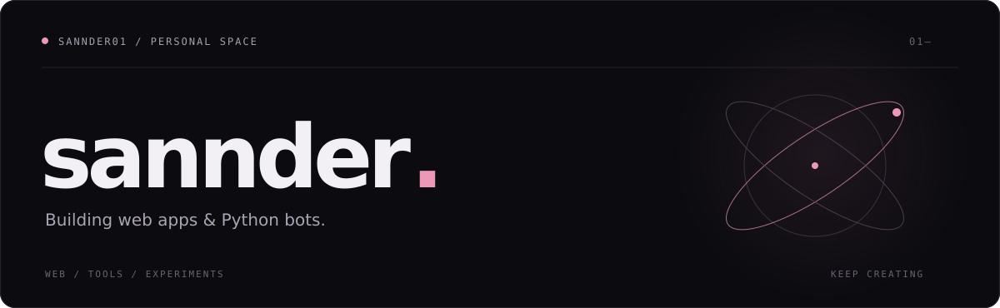
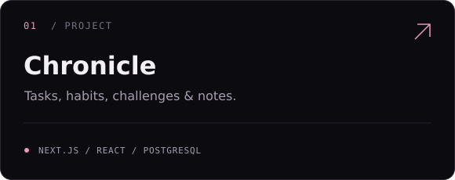
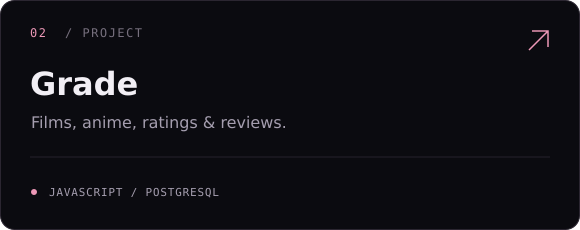
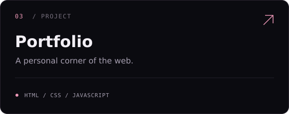
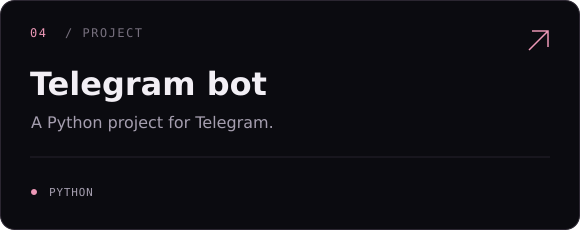

  

  <a href="https://github.com/sannder01/portfolioV3_sannder">Portfolio</a>&nbsp;&nbsp; / &nbsp;&nbsp;<a href="https://github.com/sannder01?tab=repositories">All projects</a>

 

  

 

### Selected work

  
  

  
  

 

  sannder01 &nbsp;·&nbsp; always a work in progress.

