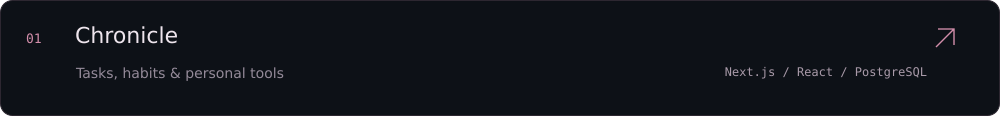
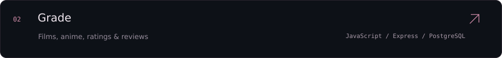
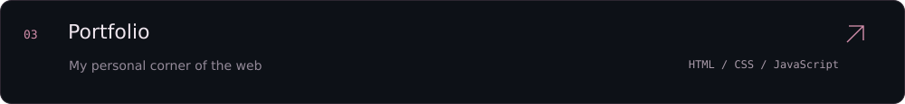
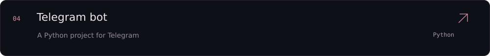
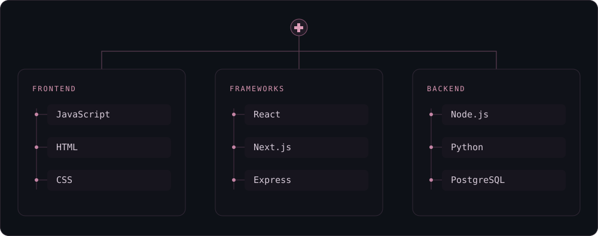

  

  <a href="https://github.com/sannder01?tab=repositories">all projects</a>&nbsp;&nbsp;·&nbsp;&nbsp;<a href="https://github.com/sannder01/portfolioV3_sannder">portfolio</a>

 

### projects

 

### skills

always growing.

